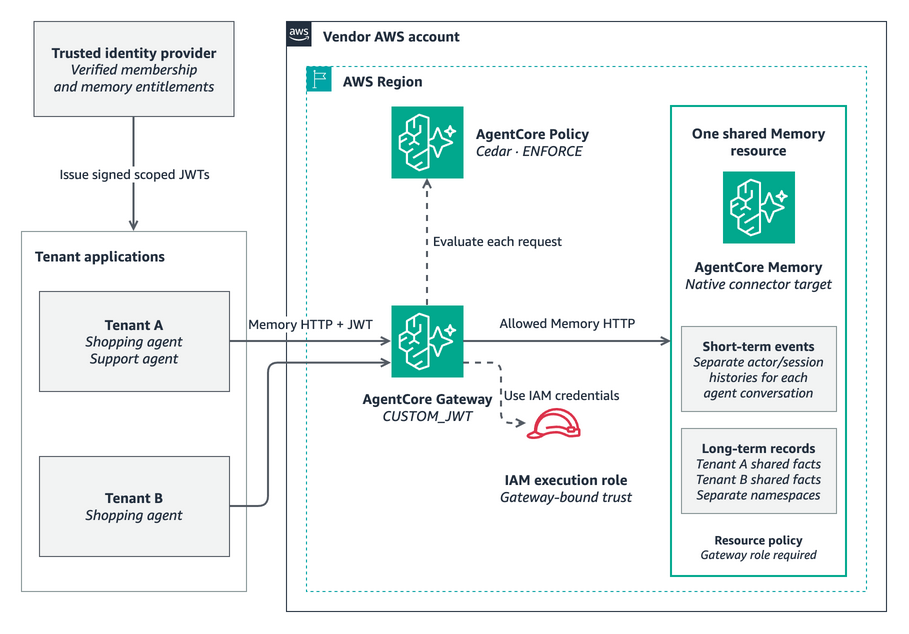

<!-- Copyright Amazon.com, Inc. or its affiliates. All Rights Reserved. -->
<!-- SPDX-License-Identifier: MIT-0 -->
# Tenant memory isolation through Gateway

A reference solution for SaaS builders designing shared agent memory with
Amazon Bedrock AgentCore Memory and AgentCore Gateway. The sample combines a
tenant memory model, signed identity claims, Cedar policies, and IAM controls
to define which conversations and facts each agent can access.

Use this solution to give multiple agents a common set of tenant facts while
keeping each agent's conversation history separate. The native
`agentcore-memory` Gateway connector provides a central entry point for
memory requests.

## Customer use cases

| Use case | Facts shared within a tenant | Conversations kept separate |
| --- | --- | --- |
| Retail assistants | A retailer's return policy, product guidance, and fulfilment rules. | Shopping and support conversations. |
| Business account assistants | An organisation's delivery requirements and support procedures. | Procurement and service conversations. |
| Internal operations assistants | A tenant's operating procedures and approved terminology. | Each team's agent conversations. |

Choose the sharing boundary around the data's audience. Tenant-wide
organisational facts fit a shared tenant namespace. Private user preferences
need a separate actor and namespace with their own access rules.

## AgentCore Memory concepts

| Construct | Purpose in this solution |
| --- | --- |
| Memory resource | The shared container for events, extraction strategies, and long-term records. |
| Actor ID | A canonical tenant identifier, such as `tenant-a`. |
| Session ID | One agent conversation within an actor, such as `shopping-001`. |
| Short-term memory | Events stored under an actor and session, preserving conversation history. |
| Memory strategy | A semantic extraction strategy that derives selected facts from events. |
| Long-term memory | Extracted records that agents can recall across conversations. |
| Namespace | A path organising long-term records, such as `/tenants/tenant-a/shared/`. |

The semantic strategy uses `/tenants/{actorId}/shared/`, placing each tenant's
extracted facts in its own namespace. Extraction is asynchronous, so new facts
become available for recall after processing.

Actors, sessions, and namespaces organise the data. Access policies define who
can read or change it.

## Reference architecture

[Editable AWS architecture diagram](diagrams/agentcore-memory-tenant-isolation.drawio).

The reference architecture combines four controls:

- **Trusted identity:** An OIDC issuer signs JSON Web Tokens (JWTs) containing
  the agent's permitted tenant actor, conversation session, and shared namespace.
- **Gateway authentication:** Gateway validates the token using `CUSTOM_JWT`
  and routes requests through the native Memory connector.
- **Request authorization:** AgentCore Policy evaluates Cedar rules in
  `ENFORCE` mode, comparing the requested memory scope with the signed claims.
- **Memory access boundary:** The Gateway execution role has permissions for
  one Memory resource. A Memory resource policy explicitly denies data access
  unless the caller is the dedicated Gateway execution role.

The execution role's trust policy limits assumption to the AgentCore service,
the vendor's account, and the relevant Gateway and Policy engine source ARNs.
Tenant scope comes from the signed JWT claims evaluated by Cedar.

## Tenant and agent memory model

The example uses two agents in Tenant A and one agent in Tenant B:

| Agent identity | `memory_actor` | `memory_session` | `memory_namespace` |
| --- | --- | --- | --- |
| Tenant A shopping | `tenant-a` | `shopping-001` | `/tenants/tenant-a/shared/` |
| Tenant A support | `tenant-a` | `support-001` | `/tenants/tenant-a/shared/` |
| Tenant B shopping | `tenant-b` | `shopping-001` | `/tenants/tenant-b/shared/` |

Have your identity provider derive these claims from verified tenant membership
and the application's conversation assignment. A permitted session is the exact
`sessionId` that the issuer authorizes for that token. The event policies match
both `actorId` and `sessionId`; reusing a session name in another tenant does
not grant access to that tenant's events.

Tenant A's shopping and support agents have different event histories and the
same long-term namespace entitlement. This supports sharing extracted facts
without granting access to each other's conversation history. Tenant B has
its own actor and namespace.

The recall policy matches the full requested `namespacePath` to
`memory_namespace`. Every descendant of that path must belong to the same
sharing boundary.

## Access policies

| Policy | Scope |
| --- | --- |
| [Event writes](policies/event-write.cedar) | `CreateEvent` for the token's actor and session in the configured Memory resource. |
| [Shared fact recall](policies/shared-recall.cedar) | `RetrieveMemoryRecords` and `ListMemoryRecords` for the token's full namespace path. |

The supplied policies require the relevant claims and request fields.
Operations without a matching permit are denied. Event writes exclude
caller-supplied extraction overrides, keeping the shared namespace assignment
under the configured strategy.

The execution role grants the three listed data operations on the configured
Memory ARN, plus the metadata and Policy permissions needed by the connector.
The Memory resource policy restricts data access to the dedicated Gateway
execution role through `aws:PrincipalArn`. Record-ID operations, tenant
enumeration, extraction administration, and batch writes are outside the
agent-facing policy set.

Keep the context needed to continue an active conversation in the application's
session layer. The reference solution exposes scoped event writes and shared
fact recall. Stored event reads and deletion remain outside its agent-facing
policy set. If your application requires stored conversation reads, introduce a
trusted service that checks the caller's tenant and session entitlement.

## Solution components

| Component | Purpose |
| --- | --- |
| [Gateway Memory client](src/gateway_memory.py) | Sends native Memory HTTP requests through a named Gateway target, using the botocore service model for serialization. |
| [Configuration renderer](src/render_config.py) | Generates Memory, Gateway, connector, IAM, and Cedar configuration for the reference architecture. |
| [Cedar policies](policies/) | Defines the conversation and shared-fact access rules. |
| [Architecture](architecture.md) | Explains the memory model and authorization boundaries. |
| [Threat model](threat-model.md) | Describes the risks and controls to consider when adapting the solution. |
| [Design specification](design/tenant-memory-isolation.spec.md) | Records the solution requirements. |
| [Architecture decisions](adr/README.md) | Explains the design choices and trade-offs. |

## Adapt the solution

1. **Define the sharing boundary.** Select the facts that all agents in a
   tenant may recall, and assign separate scopes for private data.
2. **Map application identity to memory scope.** Derive tenant, agent, and
   conversation entitlements in your trusted identity provider.
3. **Align policies with your application.** Use the supplied Cedar rules and
   resource policies as the starting point for your required Memory operations.
4. **Design the memory lifecycle.** Choose event retention, fact provenance,
   deletion, and cache boundaries for your customers' requirements.

## AWS documentation

- [Native Memory connector](https://docs.aws.amazon.com/bedrock-agentcore/latest/devguide/memory-gateway-connector.html)
- [Memory action and context reference](https://docs.aws.amazon.com/bedrock-agentcore/latest/devguide/memory-gateway-fgac.html)
- [Memory access policy examples](https://docs.aws.amazon.com/bedrock-agentcore/latest/devguide/memory-gateway-fgac-policy-examples.html)
- [HTTP Gateway target routing](https://docs.aws.amazon.com/bedrock-agentcore/latest/devguide/gateway-target-http-passthrough.html)
- [Restrict direct Memory access](https://docs.aws.amazon.com/bedrock-agentcore/latest/devguide/memory-gateway-restrict-access.html)
- [Policy evaluation IAM permissions](https://docs.aws.amazon.com/bedrock-agentcore/latest/devguide/policy-permissions.html)
